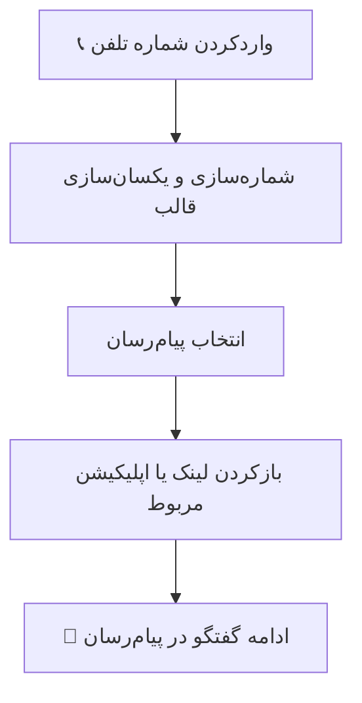

# ✨ Traceo | تریسئو

  <strong>شروع گفتگو، بدون ذخیره‌کردن شماره</strong>
   
  راهی ساده برای بازکردن پیام‌رسان دلخواه و رفتن به گفت‌وگو با یک شماره تلفن

  
  
  
  

---

## 📱 Traceo چه کاری انجام می‌دهد؟

گاهی شماره‌ی فردی را دارید و می‌خواهید در تلگرام، واتساپ یا یک پیام‌رسان دیگر به او پیام بدهید؛ اما نمی‌خواهید شماره را در مخاطبین ذخیره کنید.

**Traceo برای همین موقعیت ساخته شده است.** شماره را وارد می‌کنید، سرویس موردنظرتان را انتخاب می‌کنید و برنامه تلاش می‌کند شما را مستقیماً به همان سرویس و گفت‌وگو هدایت کند.

## 🧭 مسیر استفاده

## ✨ امکانات

- **ورود شماره تلفن:** واردکردن شماره برای شروع مسیر ارتباط.
- **یکسان‌سازی شماره‌های ایران:** تبدیل شماره‌های ایرانی به قالب استاندارد بین‌المللی ‎`+98`.
- **انتخاب سرویس:** نمایش سرویس‌های ارتباطی ایرانی و بین‌المللی.
- **هدایت به پیام‌رسان:** استفاده از لینک مستقیم یا بازکردن اپلیکیشن، در سرویس‌هایی که پشتیبانی می‌شوند.
- **رابط کاربری ساده:** تمرکز روی ورود شماره و انتخاب سرویس، بدون مراحل اضافه.

## 🔐 حریم خصوصی و محدودیت‌ها

Traceo شماره را برای پردازش و ساخت مسیر بازکردن سرویس استفاده می‌کند؛ **شماره تلفن به سرور Traceo ارسال نمی‌شود.**

Traceo ادعا نمی‌کند که می‌تواند وجود حساب کاربری یک شماره را در همه‌ی پیام‌رسان‌ها تشخیص دهد. بسیاری از سرویس‌ها API عمومی و قابل‌اتکایی برای بررسی وجود حساب ندارند. بنابراین بازشدن لینک یا اپلیکیشن به‌تنهایی به معنی وجود حساب فعال نیست و وضعیت حساب ممکن است نامشخص بماند.

## 🧩 فناوری‌های مورد استفاده

| فناوری | کاربرد |
|---|---|
| Kotlin | توسعه‌ی اپلیکیشن اندروید |
| Jetpack Compose | ساخت رابط کاربری |
| Material 3 | اجزای بصری و طراحی رابط |
| Android | بستر اجرای برنامه |

---

  <strong>Traceo — یک شماره، یک انتخاب، شروع گفتگو.</strong>

